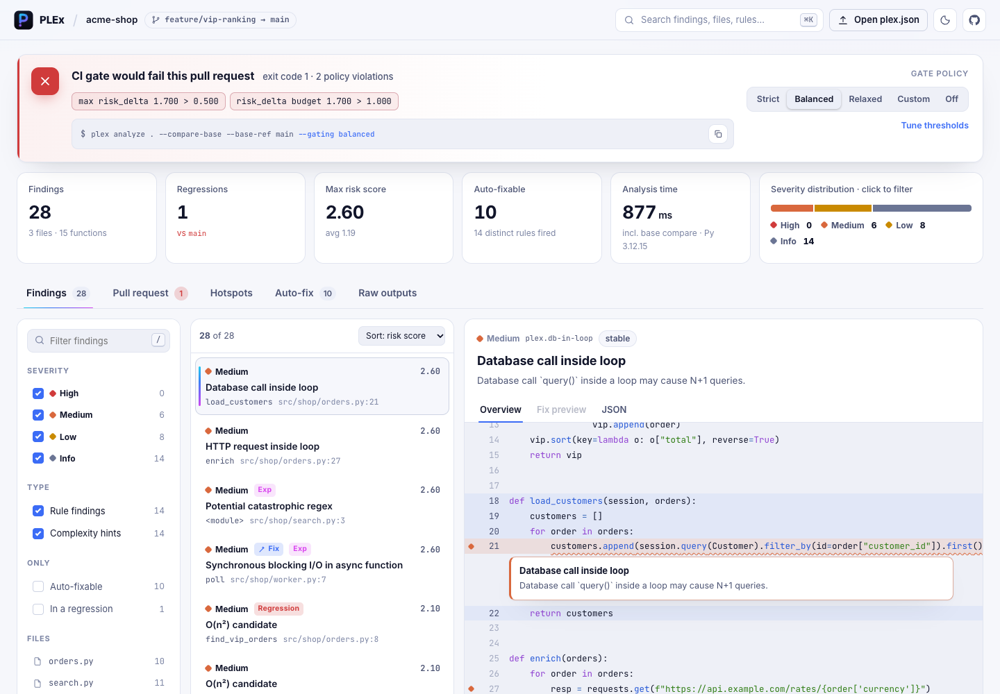

# PLEx

A developer tool that finds code problems and helps teams review performance and security changes.

[Open the demo](https://kokutbon.github.io/PLEx/) · [Technical documentation](docs/README.md)

## Features

- Check code complexity, security issues, and dependencies.
- Inspect binary files and generate JSON or SARIF reports.
- Use checks in GitHub Actions and preview suggested fixes.

## Screenshots



## Technology

Python 3.10+, command-line interface, GitHub Actions, VS Code extension.

## Run the demo locally

```sh
git clone https://github.com/KOKUTBON/PLEx.git
cd PLEx
python3 -m venv .venv
. .venv/bin/activate
pip install -e .
python scripts/build_site_data.py
python -m http.server 8765 --directory site
```

Open http://localhost:8765/. The browser demo uses sample data. See the technical documentation for the full application setup.

## License

[Apache License 2.0](LICENSE).
