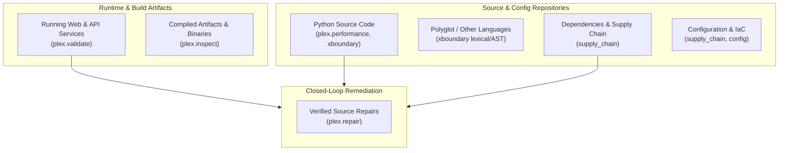

# PLEx 2.0 Declared Platform Coverage Matrix

## Overview

PLEx 2.0 natively owns analysis, validation, and repair across all core software development lifecycle surfaces. Rather than treating capabilities as a black box, PLEx formally declares and enforces its coverage, verification levels, engine ownership, and known boundaries across seven concrete surfaces.



---

## Declared Surface Inventory

| Surface | Status | Responsible Engines | Key Rules & Detection Families | Verification Mechanism |
| :--- | :--- | :--- | :--- | :--- |
| **Python Source** | **Supported** | `plex.performance`, `xboundary` | `plex.db-in-loop`, `plex.quadratic-loop`, `plex.unbuffered-io`, `xbnd.sql-injection`, `xbnd.command-injection`, `xbnd.path-traversal`, `xbnd.code-eval-taint`, `xbnd.unsafe-deserialization`, `xbnd.ssrf`, `xbnd.sensitive-data-leak`, `xbnd.insecure-cookie`, `xbnd.weak-crypto`, `xbnd.broken-tenant-isolation` | Static AST dataflow tracking, inter-procedural call graph traversal, and taint source-to-sink propagation. |
| **JS/TS and Other Languages** | **Experimental** | `xboundary` | `xbnd.generic-source` | Syntactic tokenization and manifest inventory. Full AST taint and automated repair scheduled for 2.x roadmap. |
| **Dependencies & Supply Chain** | **Supported** | `supply_chain` | `dep.unpinned-version`, `dep.insecure-index`, `dep.vulnerable-version`, `dep.reachable-vulnerability` | Pure-Python manifest parsing (`requirements.txt`, `poetry.lock`, `Pipfile.lock`), offline CVE advisory correlation, AST call-graph reachability analysis, and CycloneDX/SPDX SBOM generation. |
| **Configuration & IaC** | **Supported** | `supply_chain`, `config` | `cfg.docker-root-user`, `cfg.docker-latest-tag`, `cfg.docker-sudo-nopasswd`, `cfg.plaintext-secret`, `cfg.insecure-tls`, `cfg.insecure-headers`, `cfg.cors-wildcard`, `cfg.debug-enabled` | Pure-Python Dockerfile parser, `.env` secret entropy/assignment analyzer, and TLS/debug configuration verification. |
| **Running Web & API Services** | **Supported** | `plex.validate` | `val.sql-injection`, `val.command-injection`, `val.path-traversal`, `val.access-control`, `val.tenant-isolation`, `val.ssrf`, `val.code-injection`, `val.sensitive-data-leak`, `val.insecure-cookie`, `val.security-headers`, `val.cors-misconfiguration`, `val.debug-exposure` | Deterministic active testing recipes via `ScopedHttpClient`. Strictly bounded by authorization manifests and IP/CIDR scope. |
| **Compiled Artifacts** | **Supported** | `plex.inspect` | `bin.weak-hardening`, `bin.banned-api`, `bin.deprecated-crypto`, `bin.insecure-rpath`, `bin.hardcoded-secret`, `bin.unknown.stripped-symbols`, `bin.unknown.no-sections`, `bin.archive.zip-slip`, `bin.archive.sensitive-file`, `bin.archive.dangerous-permission` | Pure-Python 32/64-bit ELF, Mach-O, PE, and archive/package (ZIP, JAR, APK, Wheel) structural parsers, compiler mitigations, and embedded binary analysis. |
| **Remediation & Repairs** | **Supported** | `plex.repair` | `fix.performance`, `fix.sql-parameterize`, `fix.command-array`, `fix.path-boundary`, `fix.insecure-cookie`, `fix.sensitive-log-redact`, `fix.broken-tenant-isolation`, `fix.insecure-tls`, `fix.plaintext-secret`, `fix.safe-deserialization`, `fix.ssrf-url-validate`, `fix.weak-crypto`, `fix.code-eval`, `fix.docker-user`, `fix.docker-tag-pin`, `fix.docker-sudo-nopasswd`, `fix.insecure-index`, `fix.dependency-pin`, `fix.dependency-upgrade`, `fix.security-headers`, `fix.cors-allowlist`, `fix.debug-mode` | Deterministic patch synthesis in disposable workspace sandboxes with 5-gate multi-engine verification. |

---

## Accuracy & Comparative Validation Harness

To guarantee quality across updates, PLEx maintains a comparative benchmark harness evaluating detection accuracy and repair fidelity against held-out ground truth corpuses.

### Evaluation Metrics & Confusion Matrix

Every benchmark evaluation calculates:
- **True Positives ($TP$)**: Known vulnerabilities/inefficiencies correctly detected.
- **False Positives ($FP$)**: Safe idioms erroneously flagged as issues.
- **True Negatives ($TN$)**: Safe idioms correctly passed without findings.
- **False Negatives ($FN$)**: Known issues missed by the scanner.

$$\text{Precision} = \frac{TP}{TP + FP}$$
$$\text{Recall} = \frac{TP}{TP + FN}$$
$$\text{F}_1 = 2 \cdot \frac{\text{Precision} \cdot \text{Recall}}{\text{Precision} + \text{Recall}}$$

### Quality & Promotion Gates

Benchmark manifests declare explicit acceptance criteria. Engine rule updates cannot be promoted or merged unless:
1. **Precision Gate**: $\ge 95\%$ precision (strictly bounded false positives).
2. **Recall Gate**: $\ge 90\%$ recall on targeted detection rules.
3. **Zero Regression Gate**: Exactly zero newly introduced false positives or broken tests in existing verification suites.
4. **Repair Verification**: 100% of generated patches pass syntax compilation, security re-scan, active exploit re-validation, performance non-regression, and functional unit tests.

---

## CLI Usage

### Inspecting Declared Coverage

```bash
# Print formatted human-readable summary
plex coverage

# Filter coverage by surface name
plex coverage --surface "Python Source"

# Output machine-readable JSON inventory
plex coverage --json

# Emit documentation-ready Markdown table
plex coverage --markdown
```

### Running Comparative Accuracy Benchmarks

```bash
# Evaluate comparative accuracy against a declared manifest
plex benchmark --comparative path/to/manifest.json

# Save structured metrics and confusion matrix to JSON
plex benchmark --comparative path/to/manifest.json --json results/accuracy.json
```
