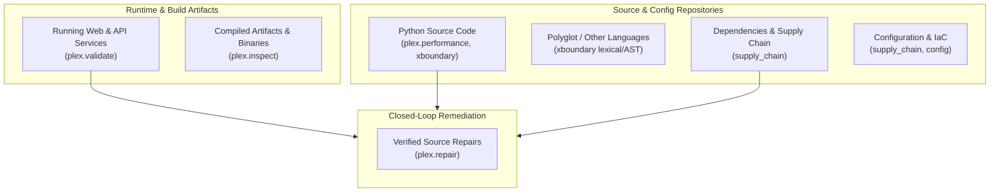

# PLEx 2.0 Declared Platform Coverage Matrix

## Overview

PLEx 2.0 declares its coverage, verification level, engine ownership and known limits for seven surfaces. `plex coverage` prints the authoritative version from `src/plex/coverage/matrix.py`.

A rule is **supported** only after it meets the promotion gates below on a held-out corpus. Rules that run and pass unit tests but have not been measured are **experimental**. As of 2026-10-15 only the Python performance rules and performance fixers are supported.



---

## Declared Surface Inventory

| Surface | Status | Responsible Engines | Key Rules & Detection Families | Verification Mechanism |
| :--- | :--- | :--- | :--- | :--- |
| **Python Source** | **Supported** (performance); Experimental (`xbnd.*`) | `plex.performance`, `xboundary` | `plex.db-in-loop`, `plex.quadratic-loop`, `plex.unbuffered-io`, `xbnd.sql-injection`, `xbnd.command-injection`, `xbnd.path-traversal`, `xbnd.code-eval-taint`, `xbnd.unsafe-deserialization`, `xbnd.ssrf`, `xbnd.sensitive-data-leak`, `xbnd.insecure-cookie`, `xbnd.weak-crypto`, `xbnd.broken-tenant-isolation`, `xbnd.open-redirect`, `xbnd.xxe`, `xbnd.mass-assignment-taint`, `xbnd.ssti`, `xbnd.nosql-injection`, `xbnd.xss` | Static AST dataflow tracking, inter-procedural call graph traversal, and taint source-to-sink propagation. |
| **JS/TS and Other Languages** | **Experimental** | `xboundary`, `plex.repair` | `xbnd.sql-injection`, `xbnd.command-injection`, `xbnd.path-traversal`, `xbnd.eval-injection`, `xbnd.nosql-injection`, `xbnd.open-redirect`, `xbnd.xss`, `xbnd.ssrf` | Pure-Python lexical (`JsTsLexer`) and dataflow taint analysis (`JsTsTaintAnalyzer`) with 6 deterministic fixers across `.js`, `.jsx`, `.ts`, `.tsx`, `.mjs`, `.cjs`. |
| **Dependencies & Supply Chain** | Experimental | `supply_chain` | `dep.unpinned-version`, `dep.insecure-index`, `dep.vulnerable-version`, `dep.reachable-vulnerability` | Pure-Python manifest parsing (`requirements.txt`, `poetry.lock`, `Pipfile.lock`), offline advisory correlation (four bundled sample advisories), AST call-graph reachability analysis, and CycloneDX/SPDX SBOM generation. |
| **Configuration & IaC** | Experimental | `supply_chain`, `config` | `cfg.docker-root-user`, `cfg.docker-latest-tag`, `cfg.docker-sudo-nopasswd`, `cfg.plaintext-secret`, `cfg.insecure-tls`, `cfg.insecure-headers`, `cfg.cors-wildcard`, `cfg.debug-enabled`, `cfg.csrf-disabled` | Pure-Python Dockerfile parser, `.env` secret entropy/assignment analyzer, and TLS/debug configuration verification. |
| **Running Web & API Services** | Experimental | `plex.validate` | `val.sql-injection`, `val.command-injection`, `val.path-traversal`, `val.access-control`, `val.tenant-isolation`, `val.ssrf`, `val.code-injection`, `val.sensitive-data-leak`, `val.insecure-cookie`, `val.unsafe-deserialization`, `val.open-redirect`, `val.xxe`, `val.mass-assignment`, `val.ssti`, `val.nosql-injection`, `val.xss`, `val.csrf-missing`, `val.security-headers`, `val.cors-misconfiguration`, `val.debug-exposure` | Technical network scope boundaries, `ScopedHttpClient`, OpenAPI 3.0/3.1 and Swagger 2.0 specification intake, Python (Flask/FastAPI/Django) and JS/TS (Express/Fastify/Next.js) route discovery, and 21 deterministic zero-LLM reproduction recipes. |
| **Compiled Artifacts** | Experimental | `plex.inspect` | `bin.weak-hardening`, `bin.banned-api`, `bin.deprecated-crypto`, `bin.insecure-rpath`, `bin.hardcoded-secret`, `bin.unknown.stripped-symbols`, `bin.unknown.no-sections`, `bin.archive.zip-slip`, `bin.archive.sensitive-file`, `bin.archive.dangerous-permission`, `bin.capability.network`, `bin.capability.process-injection`, `bin.capability.anti-analysis`, `bin.capability.persistence`, `bin.capability.dynamic-execution`, `bin.capability.command-execution`, `bin.capability.imphash`, `bin.capability.compiler-fingerprint`, `bin.capability.codesign`, `bin.capability.library-dependencies`, `bin.packing.high-entropy`, `bin.debug.exposed-path`, `bin.macho.dangerous-entitlement`, `bin.macho.unhardened-runtime`, `bin.hardening.weak-signature-digest`, `bin.elf.text-relocation` | Pure-Python 32/64-bit ELF, Mach-O, PE, and archive/package (ZIP, JAR, APK, Wheel) structural parsers; Mach-O Code Signature SuperBlob parsing, CDHash computation, entitlements extraction, Hardened Runtime analysis, PE Authenticode WIN_CERTIFICATE digest extraction, PE/ELF imphash, MSVC Rich header parsing, section entropy and cryptographic hashing, native ELF DWARF compilation unit recovery, DWARF line number state machine decoding, replaceable disassembly (pure-Python + Capstone + Objdump), pluggable decompiler backends (native lifter/Rizin/Ghidra), rebuild diffing, opt-in sandboxed runtime tracing, capability hypotheses, and source/DWARF mapping. |
| **Remediation & Repairs** | **Supported** (`fix.performance`); Experimental (all others) | `plex.repair` | `fix.performance`, `fix.sql-parameterize`, `fix.command-array`, `fix.path-boundary`, `fix.insecure-cookie`, `fix.sensitive-log-redact`, `fix.broken-tenant-isolation`, `fix.insecure-tls`, `fix.plaintext-secret`, `fix.safe-deserialization`, `fix.ssrf-url-validate`, `fix.weak-crypto`, `fix.code-eval`, `fix.docker-user`, `fix.docker-tag-pin`, `fix.docker-sudo-nopasswd`, `fix.insecure-index`, `fix.dependency-pin`, `fix.dependency-upgrade`, `fix.security-headers`, `fix.cors-allowlist`, `fix.debug-mode`, `fix.open-redirect`, `fix.xxe`, `fix.mass-assignment`, `fix.ssti`, `fix.csrf-protection`, `fix.nosql-injection`, `fix.xss`, `fix.js.sql-parameterize`, `fix.js.command-array`, `fix.js.path-boundary`, `fix.js.open-redirect`, `fix.js.nosql-injection`, `fix.js.code-eval`, `fix.unclosed-resource`, `fix.async-blocking-call`, `fix.unlocked-acquire` | Deterministic patch synthesis in disposable workspace sandboxes with 5-gate multi-engine verification and cross-engine source-to-artifact correlation. Auto-applicable fixers (explicit preconditions, abstention, failing-before/passing-after fixtures) include 17 Python/IaC/reliability fixers and 5 JS/TS fixers; 17 fixers are proposal-only per the [repair audit](REPAIR_AUDIT.md). `verified` requires a behavioral test command. |

---

## Accuracy & Comparative Validation Harness

PLEx includes a native comparative benchmark harness (`plex benchmark --comparative <dir> [--baseline <file>]`) for measuring detection accuracy and repair fidelity against held-out ground-truth corpora. 25 production benchmark manifests are maintained under `benchmarks/manifests/` evaluating Python, JavaScript/TypeScript, supply chain, Dockerfile IaC, and compiled binary inspection against pinned external baselines (`benchmarks/baselines/pinned_external_baselines.json`).

### Evaluation Metrics & Confusion Matrix

Every benchmark evaluation calculates:
- **True Positives ($TP$)**: Known vulnerabilities/inefficiencies correctly detected.
- **False Positives ($FP$)**: Safe idioms erroneously flagged as issues.
- **True Negatives ($TN$)**: Safe idioms correctly passed without findings.
- **False Negatives ($FN$)**: Known issues missed by the scanner.

$$\text{Precision} = \frac{TP}{TP + FP}$$
$$\text{Recall} = \frac{TP}{TP + FN}$$
$$\text{F}_1 = 2 \cdot \frac{\text{Precision} \cdot \text{Recall}}{\text{Precision} + \text{Recall}}$$

### Quality & Promotion Gates

Benchmark manifests declare explicit acceptance criteria. These are the target gates for promoting a rule or fixer from experimental to supported; no security rule has passed them yet:
1. **Precision Gate**: $\ge 95\%$ precision (strictly bounded false positives).
2. **Recall Gate**: $\ge 90\%$ recall on targeted detection rules.
3. **Zero Regression Gate**: Exactly zero newly introduced false positives or broken tests in existing verification suites.
4. **Repair Verification**: all declared semantic fixtures for the fixer pass, and generated patches pass syntax compilation, security re-scan, active exploit re-validation, performance non-regression, and functional unit tests.

---

## CLI Usage

### Inspecting Declared Coverage

```bash
# Print formatted human-readable summary
plex coverage

# Filter coverage by surface name
plex coverage --surface "Python Source"

# Output machine-readable JSON inventory
plex coverage --json

# Emit documentation-ready Markdown table
plex coverage --markdown
```

### Running Comparative Accuracy Benchmarks

```bash
# Evaluate comparative accuracy against a declared manifest
plex benchmark --comparative path/to/manifest.json

# Save structured metrics and confusion matrix to JSON
plex benchmark --comparative path/to/manifest.json --json results/accuracy.json
```
