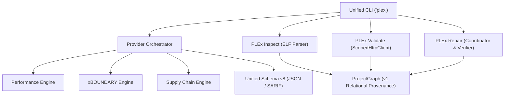

# PLEx 2.0 Migration and Architecture Guide

## Overview

PLEx 2.0 represents the transition from a specialized performance regression analyzer into a **comprehensive native software intelligence and remediation platform**. PLEx 2.0 natively owns all core analysis pillars:

1. **Performance & Complexity Intelligence**: AST static call-graph and quadratic loop detection.
2. **Static Application Security (xBOUNDARY)**: Pure-Python interprocedural dataflow and taint tracking (SQL injection, command injection, path traversal, code evaluation).
3. **Compiled Artifact Intelligence (PLEx Inspect)**: Pure-Python 32-bit and 64-bit ELF structural parser, dynamic symbol tables, and compiler hardening audits (NX, PIE, RELRO, stack canaries).
4. **Active Application Testing (PLEx Validate)**: Scope-guarded dynamic endpoint reproduction recipes (`ScopedHttpClient`), route-to-finding correlation, and redacted HTTP exchange evidence.
5. **Supply Chain & Configuration Security**: Pure-Python manifest parsing (`requirements.txt`, `poetry.lock`, `Pipfile.lock`), offline CVE advisory matching, Dockerfile privileges, and TLS audits.
6. **Closed-Loop Verified Remediation (PLEx Repair)**: Deterministic patch synthesis in disposable workspaces verified through a 5-gate pipeline (syntax, security rescan, active exploit block, performance non-regression, functional unit tests).



---

## 1. CLI Commands & Workflow Changes

In PLEx 1.x, the primary command was `plex analyze` focused strictly on performance metrics. In PLEx 2.0, the CLI exposes a cohesive suite of commands:

### `plex analyze`
Analyze source repositories with granular engine selection:
```bash
# Analyze everything (performance, static security, supply chain)
plex analyze . --checks all

# Select specific engines
plex analyze . --checks performance,xboundary,supply_chain

# Emit unified Schema v8 JSON and SARIF 2.1.0 reports
plex analyze . --json out/report.json --sarif out/report.sarif

# Enforce quality and security gating
plex analyze . --fail-on-severity high --max-findings 5
```

### `plex inspect`
Inspect compiled binaries and ELF artifacts with the native parser:
```bash
# Native pure-Python ELF analysis
plex inspect build/target.elf --engine native

# Format output as JSON or SARIF
plex inspect build/target.elf --format json -o out/inspect.json
```

### `plex validate`
Execute active, authorized dynamic reproduction against local/staging services:
```bash
# Active reproduction against endpoint with authorization guardrail
plex validate . --url http://127.0.0.1:8000 --authorize AUTHORIZATION.md
```

### `plex remediate`
Generate, verify, and apply deterministic fixes to detected vulnerabilities:
```bash
# Preview reviewable patch diff
plex remediate . --diff

# Apply verified patches to repository transactionally
plex remediate . --apply

# Export relational provenance graph
plex remediate . --out-graph out/provenance_graph.json
```

### `plex coverage`
Inspect the declared platform capabilities, verification levels, and known limitations:
```bash
# Human-readable summary
plex coverage

# Filter by surface
plex coverage --surface "Python Source"

# Export Markdown documentation table
plex coverage --markdown
```

### `plex benchmark`
Evaluate comparative accuracy and repair fidelity:
```bash
# Run comparative accuracy evaluation against held-out corpus
plex benchmark --comparative benchmarks/manifest.json
```

---

## 2. Report Schema v8 Migration

PLEx 2.0 introduces **Report Schema v8**, unifying performance metrics and security findings into a single model while preserving full backward compatibility with v7 consumers.

### Schema Differences

| Field | Schema v7 | Schema v8 |
| :--- | :--- | :--- |
| `schema_version` | `"v7"` | `8` or `"v8"` |
| `findings` | Performance findings list | Retained for v7 backward compatibility |
| `findings_unified` | *Not present* | Unified list of `AnalysisFinding` across all engines |
| `engines` | *Not present* | List of executed `EngineRun` provenance records |
| `scan_status` | *Implicit* | `"complete"`, `"partial"`, or `"failed"` |

### Backward Compatibility
Existing tools consuming v7 reports can continue parsing reports using `report.to_dict_v7()` or by requesting v7 output from the API:
```python
from plex.report import PLExReport

report: PLExReport = ...
v7_payload = report.to_dict_v7()
```

---

## 3. Configuration File Migration (`.plex.yml`)

PLEx configuration presets now support multi-engine execution rules:

```yaml
version: 2
engines:
  performance:
    enabled: true
  xboundary:
    enabled: true
    rules:
      - xbnd.sql-injection
      - xbnd.command-injection
      - xbnd.path-traversal
      - xbnd.code-eval-taint
  supply_chain:
    enabled: true

gates:
  fail_on_severity: high
  max_findings: 10
  require_clean_scan: true
```

Initialize standard configuration presets via CLI:
```bash
# Generate full multi-engine config
plex init --preset full

# Generate performance-focused config
plex init --preset performance
```

---

## 4. Sandbox Isolation & CI Hardening

In PLEx 2.0, all dynamic and subprocess operations are strictly isolated:
- **`InProcessSandbox`**: Default zero-overhead sandbox for offline static parsing.
- **`SubprocessSandbox`**: Hardened subprocess isolation with environment allowlisting (`SAFE_ENV_ALLOWLIST`) that scrubs host secrets (`AWS_SECRET_ACCESS_KEY`, `GITHUB_TOKEN`, etc.).
- **`disposable_workspace`**: Ephemeral workspace copies preventing patch attempts or tests from corrupting working directory trees.
