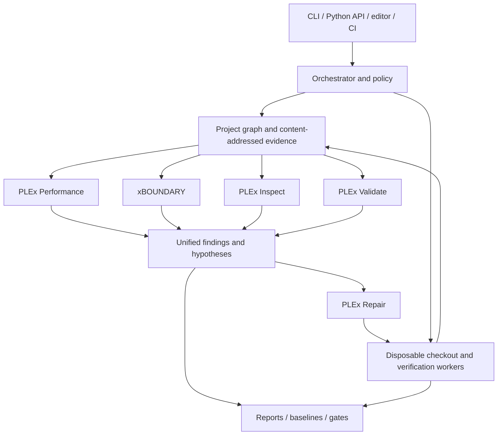

# PLEx 2.0 — Unified Software Intelligence Platform

Build native performance, security, privacy, reverse-engineering, active-testing and verified-repair capabilities inside PLEx.

- **Direction:** clarified by the project owner on 2026-10-12.
- **Implementation status:** foundations exist for every pillar; only the performance engine is supported. See section 13.
- **Decision:** [ADR 0003 — Native platform ownership](adr/0003-native-platform-ownership.md).
- **Supersedes:** the previous adapter-led REA/Strix roadmap in this file. Git history retains that proposal.

## 1. Product intent and ownership

PLEx should understand a software project, find problems across its source, dependencies, built artifacts and running behavior, propose or apply supported repairs, and verify the result. Performance analysis and xBOUNDARY are parts of that same product. Native reverse engineering and active security testing extend its understanding beyond source code.

We build and maintain the analysis models, investigation workflows, reasoning, policies, evidence, remediation and verification inside this repository. [Strix](https://github.com/usestrix/strix) is a reference for agent-assisted application security testing and remediation; [REA](https://github.com/morluto/rea) is a reference for agent-assisted reverse engineering across application behavior and native artifacts. They are comparison baselines for capabilities we intend to own. Their current primary repositories were consulted on 2026-10-12; their descriptions are not evidence of PLEx feature parity or superiority.

PLEx may use established parsers, disassemblers, decompilers, browsers, test runners, model APIs and isolation runtimes as replaceable components. We do not need to invent every instruction decoder or browser. PLEx owns the workflow and result interpretation; its native engines must be usable without installing REA or Strix. Optional result import and interoperability can follow later, outside the critical path.

“Analyze and fix everything” is the product ambition across the software lifecycle. The implementation contract is an explicit coverage matrix: each language, artifact, vulnerability family and repair is labeled supported, experimental, unsupported or incomplete. An empty report is never a claim that a project has no problems. A suggested patch is never labeled a verified repair solely because a model generated it.

## 2. Native capability map

Names for the new components below are working names; the ownership and responsibilities are the decision.

| Component | Owns | Target outcome |
| --- | --- | --- |
| **PLEx Performance** | Complexity, expensive calls, allocations, regressions, benchmarks and deterministic optimization | Detect costly behavior, repair supported patterns, verify behavior and performance |
| **xBOUNDARY** | Source security, taint, trust boundaries, authorization, secrets and privacy information flow | Explain how untrusted or sensitive data crosses a boundary and repair supported violations |
| **PLEx Inspect** | Native artifact inventory, binary/package structure, code and behavior reconstruction, evidence-based investigations | Understand what a built application contains and does, including when source is unavailable |
| **PLEx Validate** | Native application discovery, scoped active security tests, reproduction and behavioral checks | Confirm or refute hypotheses against authorized local or staging targets |
| **PLEx Repair** | Patch planning, deterministic fixers, optional model-authored patches, validation, rollback and regression prevention | Turn findings into reviewable changes with before/after evidence |
| **Shared intelligence layer** | Project graph, evidence store, scheduling, correlation, policy, reports and optional agent coordination | Make the components cooperate on one project and one repair lifecycle |

Dependency, configuration, infrastructure and reliability checks belong to this platform as well. They feed the same project graph and findings rather than becoming unrelated tools. Section 11 defines their staged coverage.

## 3. End-to-end product workflow

1. **Inventory:** identify languages, entry points, dependencies, build recipes, deployable services and supplied artifacts. Record missing inputs and unsupported formats.
2. **Understand:** build bounded symbol/call/data-flow graphs, route and trust-boundary models, and artifact/endpoint relationships with provenance.
3. **Analyze:** run selected native static engines and produce findings, evidence and explicit coverage limits.
4. **Investigate:** correlate hypotheses with artifact evidence; run selected active checks in an authorized isolated environment. Deterministic checks are available without an LLM; optional agents select and interpret tools within the same enforced policy.
5. **Repair:** select a supported deterministic fixer or propose a model-authored patch in a disposable checkout, with preconditions and intended behavior.
6. **Verify:** reproduce the original issue when feasible, apply the patch, rerun the relevant checks, test behavioral compatibility and measure relevant performance regressions.
7. **Deliver:** produce a diff or PR, a verification record and a regression check. Preserve failed checks, counterevidence and residual unknowns alongside successes.

Example acceptance scenario: xBOUNDARY identifies a request-to-SQL flow; route discovery links it to a local endpoint; PLEx Validate reproduces the issue on a fixture app; PLEx Repair proposes parameter binding; the reproduction fails after repair while functional tests pass; PLEx Performance checks the affected path for regressions. Each step is linked to the same source revision and finding. This is a target vertical slice, not current behavior.

## 4. Architecture: shared contracts, native engines

### 4.1 Preserve and evolve the existing foundation

Reuse `AnalysisFinding`, `EvidenceRef`, `EngineRun`, `PLExReport` schema v8, the provider SPI, IR, rule SDK, suppression DSL and existing performance fixers. Native engines implement the same provider lifecycle; the SPI is an internal modularity boundary as well as an extension interface.

Keep performance-only CLI behavior and supported schema v7 export compatible. Reject exports that would discard non-performance findings or incomplete-engine information. JSON and SARIF already carry native security findings; remaining formatters, shared CLI gates and editor consumers need explicit integration work. Existing type definitions and schemas are authoritative for what is implemented; design examples in this plan are future contracts.

`AnalysisTask` currently describes a repository root and target kind. Extend it deliberately to represent source snapshots, artifacts and endpoint scopes; do not overload a filesystem path with a URL. Add versioned target descriptors and capability negotiation before new target types ship.

### 4.2 Shared project graph

Add a versioned graph connecting:

- revisions, files, symbols, call sites, sources, sinks and declared data classes;
- routes, service identities, authorization roles and tenant boundaries;
- dependencies, package versions, configurations and deployment assets;
- artifact hashes, sections, imports, functions and available source/debug mappings;
- hypotheses, findings, evidence, patch candidates and verification runs.

Every edge records its producer, version, confidence and evidence. Use deterministic identities and snapshot hashes. Cross-engine relationships are explicit links, not destructive merges. Matching a CWE or function name alone does not establish that two findings are the same issue.

Start with repository/source/finding/patch relationships and route links for the first vertical slice. Add artifact and runtime relationships as those engines land. Use a local inspectable store initially; a remote graph service is not a prerequisite.

### 4.3 Evidence and verification lifecycle

Store large evidence artifacts by digest under a local run store, with schemas, provenance, source/artifact revisions, redaction and retention rules. Treat imported paths, rendered text and model/tool output as untrusted data. Never follow evidence URIs automatically during report rendering.

Keep finding status separate from repair status. Proposed repair states are `proposed`, `applied-in-workspace`, `verified`, `failed`, `inconclusive` and `reverted`. A versioned verification record links the original finding, patch digest, environment, commands, before/after results and unresolved checks. Introducing these fields requires a schema compatibility decision and tests; they are not silently assumed to exist in v8.

A finding becomes `verified` only under a rule-specific evidence contract. Correlation, model confidence or a supplied PoC file alone does not prove exploitability. A repair becomes `verified` only when its required checks pass. Missing reproduction, unavailable builds or incomplete isolation remain visible as limitations.

## 5. PLEx Performance: preserve the core and close the repair loop

Retain existing Python performance rules, baseline matching, reports, deterministic fixers and optional trusted-code measurement. Extend them through the shared workflow:

- attach fixer eligibility, preconditions and source revision to findings;
- measure relevant before/after behavior with repeated trials and environment metadata;
- check functional compatibility and security/privacy consequences of optimizations;
- record cases where the predicted improvement is not observed;
- make performance regressions a configurable check on patches from every engine.

Static complexity estimates and measured runtime are different evidence. A timing improvement does not prove semantic equivalence; a passing unit suite does not establish a universal speedup.

## 6. xBOUNDARY: native source security and privacy

### 6.1 Analysis foundation

Grow the existing bounded Python taint pass into a documented interprocedural model with framework catalogs, explicit call-resolution limits, data classes and trust boundaries. Add heap/alias and path sensitivity only with measured benefit and regression fixtures; unsupported dispatch must not silently become a clean result.

Share source models where appropriate, but keep sanitizer semantics and sink signatures specific to the vulnerability family. SQL parameter binding does not sanitize shell commands. Quoting and validation must be interpreted in their actual context. Models distinguish statement/command text from separately supplied values.

### 6.2 Rule families and order

| Wave | Families | Required evidence |
| --- | --- | --- |
| Existing experimental foundation | SQL injection; shell-command injection proposed in PR #4 | Bounded source-to-sink path, limitations, stable occurrence identity |
| Next source-security wave | Path traversal, SSRF, tainted code evaluation, unsafe deserialization | Family-specific sources/sinks, context and negative controls |
| Boundary and privacy wave | Missing authorization, cross-tenant access, secret/private-data exposure to logs, responses or third parties | Entry-point/role/data-class model and an explainable boundary crossing |
| Configuration and crypto wave | Weak crypto usage, insecure TLS, sensitive logging, dangerous defaults | API/configuration context and explicit exceptions |

Maintain CWE/OWASP mappings per rule with versioned references. Do not infer complete OWASP coverage from a few implemented rules.

### 6.3 Policy evolution

Current `.plex/security.yml` version 1 accepts additive sources, SQL sinks and SQL sanitizers. It does not implement general privacy labels, authorization invariants or command catalogs. Evolve the policy with a new version and migration guidance when those capabilities exist; validate strictly and record normalized policy digests.

Future policies declare classified data, approved destinations, tenant boundaries and required authorization at entry points. Policies are reviewable assumptions. A declaration that a function sanitizes input is not independently verified merely because the schema accepts it.

## 7. PLEx Inspect: native reverse engineering and artifact intelligence

Build a PLEx-owned investigation engine with a tool registry, bounded plans, artifact models, persistent evidence and reproducible workflows. It must handle both deterministic inspection and optional agent-assisted questions about application behavior.

### 7.1 Incremental scope

1. **Artifact intake:** hashing, type/architecture detection, size and extraction budgets, package manifests, signatures/metadata where supported. Never trust file extensions alone.
2. **First native format:** ELF inventory, sections, imports/exports, strings, hardening properties and disassembly-backed function/call evidence. Distinguish observations from heuristic interpretation.
3. **Reconstruction:** backend-assisted disassembly/decompilation, function similarity, call relationships, capability hypotheses and source/debug mapping where available.
4. **Additional formats:** PE and Mach-O, followed by APK/JAR and firmware/container/package structures, each with its own coverage and corpus. No claim of universal artifact support.
5. **Behavior investigations:** opt-in tracing in a suitable worker, comparing observations to static hypotheses and preserving unresolved questions. Hostile sample execution requires stronger isolation than a routine subprocess.

Use replaceable backends with documented versions and licenses. PLEx owns evidence normalization, investigation state, analysis rules and reasoning rather than delegating the whole investigation to REA.

### 7.2 Findings and repair boundaries

Identify supported risks such as dangerous capabilities, weak hardening, embedded secrets or suspicious data destinations with their actual context. Strings alone are leads, not proof of runtime behavior or a vulnerability. Reports retain residual unknowns and suggest the next bounded probe.

When source is available, map evidence back to source, propose a repair, rebuild and compare the new artifact. When source or a reproducible build is unavailable, report actionable guidance and the verification gap. Arbitrary binary rewriting is a separate future capability requiring semantic and artifact-integrity checks; it is not part of the initial 2.0 automatic-repair promise.

## 8. PLEx Validate: native active application testing

Build a PLEx-owned discovery, hypothesis, test and reproduction engine with a typed tool registry and deterministic checks. Optional agents plan investigations and combine observations under the same policy. An LLM is not required to execute supported test recipes.

### 8.1 Initial capabilities

- Discover routes and API surfaces from source, supplied API specifications and scoped local/staging behavior.
- Link xBOUNDARY findings to reachable endpoints and prioritize bounded hypotheses.
- Support test identities and role/tenant matrices for authentication and authorization checks.
- Build repeatable HTTP request/response and browser-session scenarios, with redacted evidence and replayable fixture data.
- Reproduce supported injection and access-control failures in deliberately vulnerable local fixture applications before expanding coverage.
- Record counterexamples, failed reproductions, timeouts and budget exhaustion rather than converting them to success.

### 8.2 Enforced execution contract

Active tests require an explicit target scope and authorization record. Static `plex analyze` does not initiate network attacks or run repository code. Tests use disposable environments and test credentials, with destination/port enforcement, redirect/DNS handling, rate limits and independent wall-clock/resource budgets. Scope must be enforced by the runtime, not only an agent prompt.

Separate model-provider traffic from target traffic. Never expose CI/host secrets by inheriting the complete environment. Persist redacted evidence and tear down workers on interruption or failure. Preflight refuses operations whose required isolation or scope controls cannot be enforced. See [ADR 0002](adr/0002-engine-isolation-model.md); its controls apply to native workers too.

### 8.3 Agent orchestration

Implement planner, executor, evidence critic and repair/verification roles incrementally, with typed inputs, tool permissions, shared state and explicit budgets. Multiple agents are a later optimization of a tested single-worker workflow. They do not substitute for checks or expand target authorization. Persist decisions and tool versions so an investigation can resume without losing its scope or evidence.

## 9. PLEx Repair: native remediation with evidence

A complete platform needs an explicit repair system shared by all engines, rather than remediation prose attached to scans.

### 9.1 Repair contract

A patch candidate records the finding IDs, source snapshot, changed files, intended behavior, eligibility/preconditions, generator/version, required checks, risk and rollback data. Prefer existing deterministic fixers for supported transformations. Use optional models for cases requiring project-specific reasoning, and label those outputs accordingly.

Support three distinct user actions: explain a repair, generate a reviewable diff, and apply it to a selected workspace. Application is opt-in and checks that the source still matches the candidate's preconditions. Repository changes are transactional; a failed attempt leaves a recoverable diff and verification log.

### 9.2 Required validation

1. Establish the original finding and a meaningful reproduction or static proof obligation. Record when a baseline already fails.
2. Validate the patch against the language and project's build/type/lint checks where available.
3. Run the issue-specific regression test and relevant behavioral tests before and after.
4. Rerun affected static/active/artifact checks, including new security/privacy problems and relevant performance regressions.
5. Record exact outcomes and unresolved gaps; a required missing check prevents `verified` status.

Tests must check intended semantics, not merely mirror generated code. Disappearance of a warning alone is insufficient repair evidence. Some issues require architectural or operational changes; these remain assisted proposals with explicit follow-up work.

### 9.3 Initial repair scope

Reuse the existing performance fixers first. Add a narrowly supported Python SQL parameter-binding repair only when the driver, call shape and query/value separation are known, with a failing-before/passing-after fixture. Ambiguous drivers, query identifiers, dynamic query builders and authorization changes need reviewed proposals. Then expand per rule with independently tested preconditions; there is no generic “sanitize all input” fixer.

Never merge or deploy a proposed patch automatically as part of analysis. Source-aware rebuild/reinspection connects repairs to compiled artifacts; opaque binaries receive analysis and guidance until a supported repair path exists.

## 10. Optional AI and local operation

PLEx owns the agent/tool loop, state and evidence. LLM backends are replaceable providers, with a local option and explicit controls over source, binaries, credentials and personal data that may leave the machine. Store provenance and redact prompts/artifacts according to policy. Treat target content as data, including instructions embedded in comments, web pages or binary strings.

AI can propose hypotheses, select allowed tools, explain results and generate patches. Deterministic engines and checks adjudicate claims within their coverage. Model agreement does not upgrade verification status. Core performance and supported static security analysis work without Docker, Node or an LLM; optional active/binary backends declare their prerequisites and limits.

## 11. Coverage across the whole project

| Surface | Initial 2.0 commitment | Expansion after that baseline |
| --- | --- | --- |
| Python source | Existing performance engine; documented security families; framework entry points and supported repair recipes | Deeper alias/path models and additional frameworks/rules |
| JS/TS and other source languages | Explicit inventory and existing supported analysis; publish per-engine gaps | JS/TS security and repair parity first, then other languages individually |
| Dependencies/supply chain | Manifest/lockfile inventory, version/provenance links; advisory checks only with a declared feed, freshness and matching model | Reachability/prioritization, SBOM correlation and verified upgrade recipes |
| Configuration/IaC/container definitions | Initial bounded secret/TLS/dangerous-default checks with file/format coverage | Deployment-aware trust and exposure analysis |
| Running web/API services | Authorized local/staging reproduction recipes and role-aware fixture tests | Broader browser/API/business-logic scenarios and stacks |
| Compiled artifacts | Native ELF static investigation and source-to-artifact links when available | PE/Mach-O, mobile/package/firmware formats and controlled tracing |
| Reliability/quality/architecture | Relevant build/tests and behavioral regressions in repair validation; graph-based dependency/call visibility | Dedicated correctness, resource-lifecycle, architectural policy and concurrency analyses |
| Repairs | Existing performance fixers and first narrowly verified security repair | More rule/language repairs, dependency/configuration changes and deeper artifact validation |

The initial commitment is an integrated, working subset across the native pillars. Python is the first complete source workflow. Other languages and formats retain individual readiness labels; a tree-sitter parser alone does not establish security or fixer support. Broader “everything” coverage continues through 2.x without shipping placeholders as completed engines.

## 12. What “better than Strix and REA” means

Treat superiority as a measurable goal on declared workloads, not a statement established by integration or feature count.

| Dimension | Measure | Planned improvement to demonstrate |
| --- | --- | --- |
| Detection quality | Per-family precision/recall, false positives, missed seeded issues and incomplete scans | Better supported-case accuracy with traceable counterevidence |
| Investigation quality | Correct evidence-backed answers, resolved/retained unknowns, time and cost per task | Source/artifact/runtime context in one reproducible investigation |
| Repair quality | Eligible issues fixed, meaningful before/after tests, unintended behavior/security/performance regressions | More verified repairs with fewer regressions |
| Reproducibility | Repeated-run agreement, snapshot/tool/policy provenance and replay success | Deterministic core and replayable active evidence |
| Efficiency | Wall time, peak memory, startup, model calls/tokens and actual cost | Useful local results and incremental analysis within stated budgets |
| Operator control | Scope containment, credential isolation, teardown and offline/local success | Enforced policies and explicit incomplete outcomes |

For a comparison, pin PLEx and baseline revisions, tool/model versions, hardware, target corpus, configuration, permissions and budgets. Use licensed seeded apps/artifacts plus held-out representative projects; publish exclusions, unsupported cases, raw results and repeated trials. Compare equivalent capabilities and report where a baseline performs better. Failed, skipped and incomplete cases must stay in the denominator where relevant.

Before a rule becomes stable, set thresholds in its benchmark manifest. Initial proposed targets are at least 95% precision and 90% recall on a held-out, labeled corpus **within the declared modeled family**, with all required traces present and no hidden incomplete cases. Report sample sizes and uncertainty; a tiny corpus is insufficient for promotion. Repair recipes require all declared semantic fixtures to pass, no observed regressions in the held-out validation set and published eligibility/abstention rates. These are targets pending corpus design, not current measured claims.

A “better” release claim requires published evidence on the named dimensions and workloads. Current synthetic cases and three PyGoat excerpts establish regression coverage only.

## 13. Current implementation inventory — 2026-10-15

Status vocabulary follows section 1: a capability is **supported** only after it meets its documented evidence contract (section 12 thresholds, held-out corpus, per-fixer semantic fixtures). Everything else that runs is **experimental**. Code that exists and passes its unit tests is not, by itself, supported.

| Capability | Actual state | What exists | Main gaps |
| --- | --- | --- | --- |
| Performance engine, rule SDK, IR, fixers, reports/editor integrations | Supported | Python performance rules, baselines, deterministic fixers, JSON/SARIF/Markdown/HTML, VS Code, GitHub Action, before/after performance regression & benchmark verification on cross-engine repairs (`RepairVerificationRunner`), and `PerformanceFixerAdapter` (`plex remediate --include-performance`) | — |
| Unified schema v8, v7 compatibility, finding/evidence/engine records | Implemented | [ADR 0001](adr/0001-unified-finding-schema.md), `AnalysisFinding.repair_status` lifecycle field (`proposed`, `applied-in-workspace`, `verified`, `failed`, `inconclusive`, `reverted`) separated from finding `status`, top-level `PLExReport.repairs` serialization, lossy v7 downgrade rejection, and `ContentAddressedEvidenceStore` (`plex-evidence://sha256/...`, secret redaction, SHA-256 verification, retention pruning) | — |
| Provider SPI, orchestrator, preflight/doctor | Implemented | `plex providers doctor`, versioned `TargetDescriptor` (`source_tree`, `artifact`, `endpoint`, `archive`) preventing URL/path overloading, and `negotiate_capability` | — |
| xBOUNDARY source security & reliability (Python, JS/TS) | Experimental | Bounded AST/lexical taint for Python (~20 families, including `xbnd.missing-authorization`) and JS/TS (8 families: SQL, command, path, eval, NoSQL, redirect, XSS, SSRF; including interprocedural helper & cross-module taint propagation via `JsTsFunctionSummary`, `extract_jsts_function_summaries`, and `analyze_jsts_project`), native `ReliabilityAnalyzer` (`rel.unclosed-resource`, `rel.async-blocking-call`, `rel.unlocked-acquire`, `arch.layer-violation` via `.plex/architecture.json`), plus Security Policy v2 (`.plex/security.yml`, `version: 2`, `schema/security-policy-v2.schema.json`) with multi-family `sources`/`sanitizers`/`sinks`, `data_classes`, `tenant_boundaries`, `authorization_invariants`, `approved_destinations`, and `migrate_policy_v1_to_v2` | Large-scale external third-party held-out corpus expansion |
| Supply chain & IaC | Implemented | Manifest parsers (Python requirements, Node `package.json` / `package-lock.json` v1–v3), SBOM (CycloneDX/SPDX with `pkg:pypi` and `pkg:npm` PURLs), AST reachability, Dockerfile/TLS/config rules, declared advisory feeds (`AdvisoryFeed`), built-in advisories (PyPI & NPM), freshness tracking, OSV format intake, HTTP/HTTPS remote mirror fetching with SHA-256 verification (`AdvisoryFeed.from_url`), offline `FeedMirrorCache`, and `plex supply-chain feed sync` | — |
| PLEx Inspect (reverse engineering) | Experimental | Pure-Python ELF, Mach-O (incl. FAT), PE, ZIP/JAR/APK/Wheel structural parsing; hardening, banned-API, string/secret rules ([ADR 0007](adr/0007-native-artifact-inspection.md)); PE imphash, MSVC Rich header parsing, section entropy & cryptographic hashing, native ELF DWARF compilation unit recovery (`plex.inspect.dwarf`), replaceable disassembly backends (pure Python + Capstone + Objdump), instruction normalization, function/call reconstruction, structured pseudo-C lifting, pluggable decompiler backends (`NativeLifterDecompiler`, `RizinDecompiler`, `GhidraHeadlessDecompiler`) & function similarity (`plex.inspect.decompile`), source-to-artifact rebuild & diff comparison (`plex.inspect.rebuild`), opt-in sandboxed runtime tracing (`plex.inspect.trace`, `--allow-dynamic`), and CLI `--decompile`, `--diff-against`, `--rebuild-cmd` | — |
| PLEx Validate (active testing) | Experimental | `ScopedHttpClient`, `StatefulSessionClient`, HTML form/DOM and CSRF token extraction (`plex.validate.session`), repeatable browser/DOM session scenarios (`BrowserSessionRunner`, `SimulatedDomBrowserBackend`, `HeadlessBrowserBackend`, `plex validate --scenario`) with replayable fixtures (`plex.validate.browser`, `plex validate --save-fixture` / `--replay-fixture`), authorization record, Flask/FastAPI/Django/Express/Fastify/Next.js route discovery, OpenAPI 3.0/3.1 & Swagger 2.0 spec intake, 21 deterministic HTTP recipes ([ADR 0006](adr/0006-native-active-validation.md)), and live reference vulnerable app evaluation | — |
| PLEx Repair | Experimental | 32 Python/IaC/reliability fixers plus 6 JS/TS fixers and performance fixers (`PerformanceFixerAdapter`), `RemediationCoordinator`, multi-gate `RepairVerificationRunner` with pre/post performance delta, runtime benchmark trials, and source-to-artifact rebuild & binary re-inspection (`artifact_rebuild_verified`), `plex remediate --rebuild-cmd` ([ADR 0008](adr/0008-integrated-intelligence-and-repair.md)) | 19 of 32 Python/IaC/reliability fixers are proposal-only; `fix.sql-parameterize`, `fix.command-array`, `fix.path-boundary`, `fix.nosql-injection`, `fix.ssti`, `fix.xss`, `fix.open-redirect`, `fix.safe-deserialization`, `fix.unclosed-resource`, `fix.docker-user` (for declared or standard base image users), `fix.insecure-index` (for official PyPI domains), `fix.insecure-cookie` (for session/auth tokens under HTTPS or explicit `httponly=False`), and `fix.async-blocking-call` (for `time.sleep` in `async def`) meet the auto-apply contract. Runner requires behavioral tests for `verified` |
| Sandboxes and isolation | Implemented | `InProcessSandbox`, `SubprocessSandbox`, `ContainerSandbox`, `MicroVMSandbox` (`isolation="virtual-machine"`), env allowlist, `disposable_workspace` ([ADR 0002](adr/0002-engine-isolation-model.md)) | — |
| Project graph and correlation | Implemented | `ProjectGraph` v1 and `GraphCorrelator` with source, route, dependency, artifact, and runtime execution (`"executes_at_runtime"`) edges, used by the remediation coordinator and persisted via `plex analyze --graph <path>` | — |
| Coverage matrix and comparative benchmark harness | Completed | `plex coverage`, `plex benchmark --comparative <dir> [--baseline <file>]` ([ADR 0009](adr/0009-coverage-and-comparative-validation.md)), held-out corpora (`benchmarks/corpora/`), 25 production manifests (`benchmarks/manifests/`, including `python_reliability.json`, `python_authorization.json`, `python_open_redirect.json`, `python_xss.json`, `python_nosql_injection.json`, `python_unsafe_deserialization.json`, `supply_chain_dependencies.json`, `config_iac_dockerfile.json`, `python_async_blocking.json`, `python_unlocked_acquire.json`, `config_docker_latest_tag.json`, `config_docker_sudo.json`, `python_weak_crypto.json`, `python_insecure_cookie.json`), and pinned external baseline delta comparison (`ExternalBaselineRecord`, `compare_against_pinned_baseline`, `benchmarks/baselines/pinned_external_baselines.json`) | — |
| Optional AI / agent layer | Implemented | `ModelProvider` interface, offline `LocalMockModelProvider`, local `OllamaModelProvider`, `OpenAICompatibleProvider`, `SingleWorkerAgent` loop with resumable checkpoints (`SingleWorkerAgent.from_checkpoint`, `plex agent --resume`, `scope_digest` & `tool_versions`), and `MultiWorkerCoordinator` (`plex agent --team --workers <n>`) with technical scope controls ([ADR 0002](adr/0002-engine-isolation-model.md), [ADR 0008](adr/0008-integrated-intelligence-and-repair.md)) | — |

The foundation for every pillar exists and the test suite passes. All 8 roadmap phases (P0–P8) have completed their foundation deliverables and pre-release exit criteria.

## 14. Execution roadmap and exit criteria

| Phase | Deliverable | Status |
| --- | --- | --- |
| **P0 — Correct the direction** | Native-platform plan, ADR and roadmap links | **Completed** ([ADR 0003](adr/0003-native-platform-ownership.md)) |
| **P1 — Existing foundation** | Unified reports, provider SPI, experimental xBOUNDARY | **Completed** (Schema v8, provider orchestrator) |
| **P2 — Shared workflow and execution contracts** | Multi-engine CLI selection/formats/gates; initial graph/evidence/repair schemas; hardened worker foundations | **Completed** — graph persisted by CLI (`--graph`); repair verification schema enforced |
| **P3 — First verified source repair** | Native xBOUNDARY → repair → regression-test slice; additional source families | **Foundation implemented** — 8 fixers meet strict contract with verified tests; 24 are proposal-only |
| **P4 — Native artifact intelligence** | PLEx Inspect intake, backend interface, static evidence/rules, source/artifact links | **Foundation completed** — structural parsers (ELF, PE, Mach-O, archive), replaceable disassembly (pure Python + Capstone + Objdump), function/call reconstruction, pseudo-C lifting, pluggable decompiler backends & function similarity (`decompile.py`), rebuild diffing (`rebuild.py`), opt-in runtime tracing (`trace.py`), capability hypothesis engine (`bin.capability.*`), and source/debug mapping (`SourceDebugMapper`) via `plex inspect --source` |
| **P5 — Native active validation** | Route/hypothesis/test engine; authorized workers; local injection and role/tenant fixtures | **Foundation completed** — route discovery across Python (Flask, FastAPI, Django) and JS/TS (Express, Fastify, Next.js), OpenAPI 3.0/3.1 and Swagger 2.0 specification intake, stateful session & HTML form/CSRF extraction (`session.py`), browser/DOM scenario runner & replayable fixtures (`browser.py`, `plex validate --scenario` / `--replay-fixture`), route-guided hypothesis generation, 21 deterministic recipes, and live reference-app active evaluation |
| **P6 — Integrated intelligence and repair** | Source/artifact/runtime correlation; native repair plans and verification across engines | **Foundation completed** — end-to-end remediation coordinator (`RemediationCoordinator`), cross-engine `ProjectGraph` correlation (`"artifact"`, `"symbol"`, `"call_site"` nodes linked via `"maps_to"`, `"detects"`, `"executes_at_runtime"`), before/after performance & security cross-checking, source-to-artifact rebuild & binary re-inspection (`artifact_rebuild_verified`), and CLI `plex remediate --artifact <bin> --rebuild-cmd <cmd> --include-performance` |
| **P7 — Coverage and comparative validation** | Dependency/configuration checks, declared coverage matrix, held-out corpora and pinned baseline comparisons | **Completed** — declared coverage matrix (`plex coverage`), held-out benchmark corpora (`benchmarks/corpora`), 13 multi-engine validation manifests (`benchmarks/manifests`), pinned external baseline comparison (`compare_against_pinned_baseline`, `benchmarks/baselines/pinned_external_baselines.json`), and directory runner (`plex benchmark --comparative <dir> [--baseline <file>]`) |
| **P8 — PLEx 2.0 release** | Cohesive CLI/API/dashboard/editor/CI, migration docs, reproducible packages and supported native pillars | **Completed** — cohesive unified CLI across all 7 platform pillars, comprehensive migration & architecture guides, reproducible clean packaging (`python3 -m build`), and verified release readiness audit (`RELEASE_READINESS_AUDIT.md`) |

### Next increments, in order

1. ~~Make `fix.sql-parameterize` driver-aware and abstain when the driver is unknown~~ (done 2026-10-15); audit of the other fixers done ([REPAIR_AUDIT.md](REPAIR_AUDIT.md)); they are proposal-only until rewritten to the same contract, starting with the injection fixers (`fix.command-array` and `fix.path-boundary` done 2026-10-15; `fix.code-eval` rewritten as a proposal-only repair; `fix.nosql-injection` done 2026-10-15).
2. ~~Build comparative benchmark harness and comparative runner~~ (done 2026-10-16 via `plex benchmark --comparative`); publish per-rule precision/recall on held-out corpus.
3. ~~Demonstrate the section 3 acceptance scenario end to end, with the `ProjectGraph` persisted by the CLI~~ (done 2026-10-16 via `plex analyze --graph <path>`).
4. ~~Add a replaceable disassembly backend and function/call reconstruction to PLEx Inspect~~ (done 2026-10-16).
5. ~~Add the optional model-provider interface and a single-worker agent loop under the existing scope controls~~ (done 2026-10-16).
6. ~~JS/TS taint and repair~~ (done 2026-10-16 with `plex.security.jsts_taint` and `plex.repair.jsts`).
7. ~~Complete the release checklist and pre-release gates~~ (done 2026-10-16; documented in [RELEASE_READINESS_AUDIT.md](RELEASE_READINESS_AUDIT.md)).
8. ~~Add binary capability hypothesis detection and source/debug mapping to PLEx Inspect~~ (done 2026-10-16; `bin.capability.*` and `SourceDebugMapper` with `--source`).
9. ~~Add OpenAPI/Swagger specification intake, JS/TS route discovery, and reference vulnerable app active evaluation to PLEx Validate~~ (done 2026-10-16; `parse_openapi_spec`, `_discover_jsts_routes`, `ValidateEngine(spec_path=...)`, `--spec <path>`, and live reference app test suite).
10. ~~Add native source-to-artifact graph correlation and remediation to PLEx Repair~~ (done 2026-10-16; `add_artifact`, `correlate_source_artifact`, `add_artifact_finding`, `plex remediate --artifact <bin>`, and cross-engine integration test suite).
11. ~~Build held-out benchmark corpora, multi-engine comparative validation manifests, and directory benchmark runner~~ (done 2026-10-16 with `benchmarks/corpora`, `benchmarks/manifests`, `InspectEngine` & `XBoundaryProvider` comparative runner integration, and `plex benchmark --comparative <dir>`).
12. ~~Cohesive PLEx 2.0 release documentation, pre-release packaging verification, and multi-pillar sync~~ (done 2026-10-16; `docs/ARCHITECTURE.md`, `docs/MIGRATION_2.0.md`, `README.md`, `docs/RELEASE_READINESS_AUDIT.md`, and clean `python3 -m build` verification).
13. ~~Declared vulnerability advisory feeds, freshness model, OSV format intake, and version range matching for Supply Chain~~ (done 2026-10-16 with `AdvisoryFeed`, `BUILTIN_FEED`, `plex supply-chain feed`, `--advisory-feed`, and test suite).
14. ~~Unified Schema v8 repair-status and verification-record contract plus before/after performance measurement on cross-engine repairs~~ (done 2026-10-17 with `AnalysisFinding.repair_status`, `PLExReport.repairs`, `PerformanceFixerAdapter`, `--include-performance`, `--benchmark-cmd`, and pre/post delta verification in `RepairVerificationRunner`).
15. ~~Security Policy v2 evolution across multi-family sinks, sanitizers, data classes, tenant boundaries, authorization invariants, and approved destinations~~ (done 2026-10-17 with `schema/security-policy-v2.schema.json`, `migrate_policy_v1_to_v2`, and `SQLDataflow` / `BrokenTenantIsolationRule` integration).
16. ~~PLEx Inspect structured pseudo-C reconstruction, binary function similarity, source-to-artifact rebuild comparison, and opt-in sandboxed runtime tracing~~ (done 2026-10-17 with `plex.inspect.decompile`, `plex.inspect.rebuild`, `plex.inspect.trace`, and `ProjectGraph` `"executes_at_runtime"` correlation).
17. ~~Multi-worker parallel specialist team coordination for the autonomous agent layer~~ (done 2026-10-17 with `MultiWorkerCoordinator`, `TeamState`, `WorkerTask`, `WorkerReport`, and `plex agent --team --workers <n>`).
18. ~~Stateful HTTP session management and HTML form/DOM + CSRF token extraction for PLEx Validate~~ (done 2026-10-17 with `StatefulSessionClient`, `ExtractedHtmlForm`, `extract_html_forms`, `extract_meta_csrf_tokens`, and `ScopedHttpClient` cookie jar persistence).
19. ~~Pluggable decompiler backends (`NativeLifterDecompiler`, `RizinDecompiler`, `GhidraHeadlessDecompiler`) and CLI decompile/diff/rebuild flags for PLEx Inspect~~ (done 2026-10-17 with `--decompile`, `--decompiler-backend`, `--diff-against`, and `--rebuild-cmd`).
20. ~~Remote advisory feed synchronization, SHA-256 provenance verification, and offline mirror caching for Supply Chain~~ (done 2026-10-17 with `AdvisoryFeed.from_url`, `FeedMirrorCache`, and `plex supply-chain feed sync`).
21. ~~Repeatable browser/DOM session scenario runner and deterministic replayable fixture engine for PLEx Validate~~ (done 2026-10-17 with `BrowserSessionRunner`, `SimulatedDomBrowserBackend`, `HeadlessBrowserBackend`, and `BrowserScenarioResult`).
22. ~~MicroVM isolation boundary (`MicroVMSandbox`) and versioned `TargetDescriptor` / capability negotiation~~ (done 2026-10-17 with `MicroVMSandbox`, `TargetDescriptor`, and `negotiate_capability`).
23. ~~Expanded held-out multi-family corpora & manifests and pinned external baseline delta comparison~~ (done 2026-10-17 with `ExternalBaselineRecord`, `BaselineComparisonDelta`, `compare_against_pinned_baseline`, `benchmarks/baselines/pinned_external_baselines.json`, and 9 held-out manifests across Python, JS/TS, and binaries).
24: ~~Native resource-lifecycle, concurrency hazard, and architectural layer boundary policy analyzer (`plex.reliability`)~~ (done 2026-10-17 with `ReliabilityAnalyzer`, `LayerBoundaryRule`, `ReliabilityProvider`, `rel.unclosed-resource`, `rel.async-blocking-call`, `rel.unlocked-acquire`, and `arch.layer-violation`).
25. ~~CLI browser scenario execution (`plex validate --scenario` / `--save-fixture` / `--replay-fixture`) and declared coverage matrix sync (`plex.coverage.matrix`)~~ (done 2026-10-17).
26. ~~Content-addressed local evidence run store with secret redaction, SHA-256 integrity verification, and retention window pruning (`plex.evidence.store`)~~ (done 2026-10-17 with `ContentAddressedEvidenceStore`, `EvidenceArtifactMetadata`, `StoredEvidenceArtifact`, and `redact_sensitive_text`).
27. ~~Resumable agent investigation checkpoints with pinned tool versions and cryptographic scope digest verification (`plex.agent`)~~ (done 2026-10-17 with `AgentScopePolicy.compute_scope_digest`, `AgentState.tool_versions` / `scope_digest`, `SingleWorkerAgent.from_checkpoint`, and `plex agent --resume <checkpoint>`).
28. ~~CLI pinned baseline delta reporting (`plex benchmark --comparative --baseline`) and proposal-only resource lifecycle repair (`UnclosedResourceFixer`)~~ (done 2026-10-17 with `UnclosedResourceFixer` for `rel.unclosed-resource` and `RepairVerificationRunner` reliability rescan integration).
29. ~~Interprocedural JavaScript/TypeScript helper function & cross-module taint propagation (`plex.security.jsts_taint`)~~ (done 2026-10-17 with `JsTsFunctionSummary`, `extract_jsts_function_summaries`, `analyze_jsts_project`, and `XBoundaryProvider` cross-file summary sharing).
30. ~~Source-to-artifact rebuild and binary re-inspection verification in `RepairVerificationRunner` and `plex remediate`~~ (done 2026-10-17 with `artifact_rebuild_verified` check, `rebuild_command`, and `--rebuild-cmd`).
31. ~~Proposal-only concurrency fixers (`AsyncBlockingCallFixer`, `UnlockedAcquireFixer`) and held-out `python_reliability` benchmark corpus~~ (done 2026-10-17 with `src/plex/repair/reliability_fixes.py`, `benchmarks/corpora/python_reliability/`, and `benchmarks/manifests/python_reliability.json`).
32. ~~Multi-engine CLI selection (`--checks reliability`, `--checks all`), `--evidence-store` persistence with `plex-evidence://sha256/` URIs, non-double-counted shared gating, and multi-format report synchronization~~ (done 2026-10-17 with `plex analyze --checks`, `--evidence-store`, Markdown, comment, check-run, and annotation formatters).
33. ~~Missing authorization detection (`xbnd.missing-authorization`), proposal-only repair (`MissingAuthorizationFixer`), active role-matrix validation (`val.access-control`, `RoleMatrixRecipe`), and held-out authorization benchmark corpus~~ (done 2026-10-17 with `MissingAuthorizationRule`, `MissingAuthorizationFixer`, `RoleMatrixRecipe`, and `benchmarks/corpora/python_authorization/`).
34. ~~NPM lockfile & manifest parsing (`package-lock.json` v1–v3, `package.json`), built-in NPM advisories, NPM SBOM PURLs, supply-chain & Dockerfile benchmark corpora, and coverage matrix synchronization~~ (done 2026-10-17 with `parse_package_lock_json`, `parse_package_json`, `lodash`/`express` advisories, `pkg:npm` PURLs, `benchmarks/manifests/supply_chain_dependencies.json`, `benchmarks/manifests/config_iac_dockerfile.json`, and `plex.coverage.matrix`).
35. ~~Held-out benchmark corpora & manifests expansion for verified and experimental rules (`xbnd.open-redirect`, `xbnd.xss`, `xbnd.nosql-injection`, `xbnd.unsafe-deserialization`, `xbnd.code-eval-taint`, `xbnd.ssrf`) with pinned external baseline comparisons~~ (done 2026-10-18 with 6 new manifests, failing-before/passing-after behavioral fixtures, and pinned Semgrep/Bandit deltas across 19 production manifests).
36. ~~Promote proposal-only fixers (`fix.unclosed-resource`, `fix.docker-user`) to verified auto-apply with strict AST preconditions, abstention bounds, and behavioral test fixtures~~ (done 2026-10-18 with AST escape analysis, declared user/base image detection, and 23 comprehensive tests in `tests/test_increment_36_track_b_repairs.py`).
37. ~~Held-out benchmark corpora & manifests expansion for reliability, IaC, and cryptography rules (`rel.async-blocking-call`, `rel.unlocked-acquire`, `cfg.docker-latest-tag`, `cfg.docker-sudo-nopasswd`, `xbnd.weak-crypto`, `xbnd.insecure-cookie`) with pinned external baseline comparisons~~ (done 2026-10-18 with 6 new manifests, failing-before/passing-after behavioral fixtures, and pinned Semgrep/Bandit/Hadolint deltas across 25 production manifests).
38. ~~Promote proposal-only fixers (`fix.insecure-index`, `fix.insecure-cookie`, `fix.async-blocking-call`) to verified auto-apply with strict host/token AST preconditions, abstention bounds, and behavioral test fixtures~~ (done 2026-10-18 with official PyPI domain gating, session/HTTPS cookie classification, async sleep AST rewriting, and 11 comprehensive tests in `tests/test_increment_38_track_b_repairs.py`).
39. ~~Native PE import hash (imphash), Rich Header parsing, Section entropy & hashing, and ELF DWARF compilation unit recovery in PLEx Inspect~~ (done 2026-10-19 with `compute_imphash`, `parse_rich_header`, `parse_dwarf`, `compute_section_metrics`, `bin.capability.imphash`, `bin.capability.compiler-fingerprint`, `bin.packing.high-entropy`, `bin.debug.exposed-path`, and comprehensive test suite in `tests/test_increment_39_artifact_intelligence.py`).
40. ~~Promote proposal-only fixers (`fix.docker-tag-pin`, `fix.tls-verify`) to verified auto-apply with repository runtime discovery (.python-version, runtime.txt, pyproject.toml, Pipfile, .nvmrc, .node-version, package.json, go.mod), public HTTPS verification, and loopback/test abstention~~ (done 2026-10-19 with `discover_project_runtimes`, URL target classification, test harness detection, and 24 comprehensive tests in `tests/test_increment_40_track_b_repairs.py`).
41. ~~Native Mach-O Code Signature & Entitlements Analysis, Apple Hardened Runtime verification, PE Authenticode digest extraction, and Code Signing capabilities in PLEx Inspect~~ (done 2026-10-19 with `CS_SuperBlob`, `CS_CodeDirectory`, `CS_Entitlements` XML plist parser, CDHash calculation matching `codesign`, PE `WIN_CERTIFICATE` PKCS#7 OID extraction, `bin.macho.dangerous-entitlement`, `bin.macho.unhardened-runtime`, `bin.hardening.weak-signature-digest`, `bin.capability.codesign`, and comprehensive test suite in `tests/test_increment_41_codesign_intelligence.py`).
42. ~~Promote proposal-only fixers (`fix.weak-crypto`, `fix.docker-sudo`) to verified auto-apply with cryptographic/non-cryptographic context classification (FIPS `usedforsecurity=False` injection vs SHA-256 upgrade), unprivileged container privilege drops, sudo command absence preconditions, and behavioral test fixtures~~ (done 2026-10-19 with context-aware crypto rewriting, multi-line / chained sudoers stripping, failing-before/passing-after benchmark manifests and corpora, and 38 passing tests including `tests/test_increment_42_track_b_repairs.py`).
43. ~~Native ELF import hashing (`elf_imphash`), shared library dependency graph (`DT_NEEDED`), text relocation detection (`DT_TEXTREL`), DWARF line number state machine opcode decoding, and subprogram boundary recovery in PLEx Inspect~~ (done 2026-10-19 with `compute_elf_imphash`, `find_source_location`, `parse_dwarf_line_table`, `parse_dwarf_subprograms`, `bin.elf.text-relocation`, `bin.capability.library-dependencies`, DWARF address-to-line SourceDebugMapper integration, and comprehensive test suite in `tests/test_increment_43_track_d_elf_dwarf.py`).

No next milestone is “wrap REA” or “wrap Strix.” Any interoperability work is separately justified after the native path is useful.

## 15. Release gates and maintenance

- Native performance, xBOUNDARY, Inspect, Validate and Repair each have documented working workflows and a coverage matrix. Stubs and imports do not satisfy a pillar.
- The integrated source → finding → reproduction → patch → verification scenario passes in controlled fixtures; source → artifact inspection is reproducible where build inputs exist.
- Reports preserve rule identity, evidence, limitations and engine status across supported formats. Shared gates do not double-count legacy performance mirrors or treat unavailable requested engines as clean.
- No silent scope expansion, privileged target execution or host-secret inheritance; cleanup, cancellation, stale snapshots, path traversal and malformed evidence are tested.
- Offline deterministic workflows and a documented local-model option work within their declared prerequisites; optional components fail clearly when unavailable.
- Corpus provenance, third-party component licenses, comparative results, known limitations and regression budgets are published. Follow [RELEASE_CHECKLIST.md](../RELEASE_CHECKLIST.md), SBOM/signing and existing supply-chain checks.
- Keep a single user-facing project and distribution. Optional binary/active/model dependencies load lazily; choose actual extras when backends are selected, rather than introducing empty REA/Strix adapter extras.
- Preserve package/CLI compatibility unless a documented migration is required. Choose the SemVer transition and PyPI publication details at release readiness; this plan does not publish a release.

## 16. Risks and decisions to revisit

| Risk | Response |
| --- | --- |
| Breadth outgrows maintainer capacity | Small vertical slices, explicit coverage, shared contracts and measured promotion; no universal-completeness claim |
| Expensive native reverse-engineering work | Reuse replaceable low-level tools while owning investigation, rules, evidence and verification |
| False confidence from correlation or AI | Separate observations, hypotheses, verified findings and verified repairs |
| Patches remove warnings but change behavior | Preconditions, before/after semantic checks, abstention and regression measurements |
| Active/sample execution escapes scope | Enforced runtime policy, dedicated workers and stronger isolation for hostile execution |
| Benchmark overfitting or unfair comparisons | Held-out targets, pinned baselines, equivalent permissions/budgets, published failures and uncertainty |
| Schema churn and duplicate counts | Versioned contracts, compatibility fixtures and explicit migration before new consumers depend on them |

Backend selection, supported host/architecture matrix, model providers, corpus composition and detailed promotion thresholds are implementation decisions requiring evidence. They do not reopen the owner's clarified decision to build the native capabilities inside PLEx.
