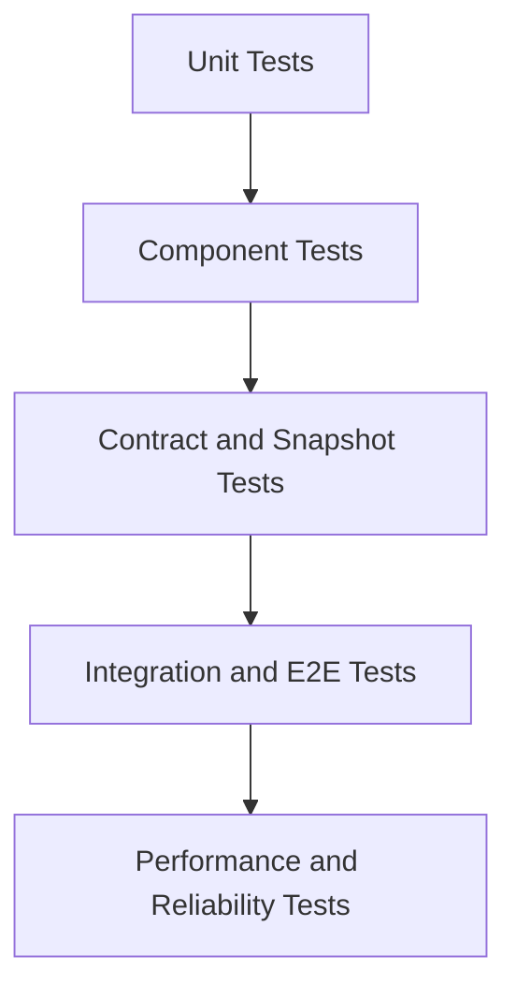

# Testing Strategy

This strategy defines how PLEx validates correctness, reliability, and
user-facing behavior.

## Testing objectives

- Guarantee deterministic core analysis output.
- Prevent regressions in user-facing reports and CI gates.
- Ensure performance and reliability under scale.

## Test pyramid

## Test layers

### 1. Unit tests

- Pure function behavior (signals, scoring, severity mapping).
- Rule-level fixture validation.
- Formatter rendering invariants.

### 2. Component tests

- Analyzer + IR interplay.
- Rule execution pipeline.
- Baseline compare and gating evaluation.

### 3. Contract tests

- JSON schema compatibility.
- SARIF/check-run payload validity.
- Snapshot tests for Markdown/HTML/snippets outputs.

### 4. Integration tests

- CLI smoke tests on representative repositories.
- Git diff and baseline artifact workflows.
- GitHub Action e2e compatibility.

### 5. Non-functional tests

- Benchmark harness regression checks.
- Latency, throughput, and memory budgets.
- Reliability chaos tests for optional distributed mode.

## Quality gates

Minimum CI gates:

- Lint (`ruff`).
- Type check (`mypy`).
- Unit and component tests (`pytest`).
- Snapshot contract checks.

Recommended additional gates:

- Coverage thresholds by module criticality.
- Flaky test budget and quarantine policy.
- Security tests (SAST/dependency and API misuse tests).

## Test data strategy

- Synthetic fixture corpora for common true/false positive patterns.
- Versioned benchmark datasets for performance drift tracking.

## Release validation

Before release:

- Full CI matrix green.
- Schema and report compatibility checks.
- Benchmark delta review against baseline thresholds.
- Security checklist and dependency review complete.
